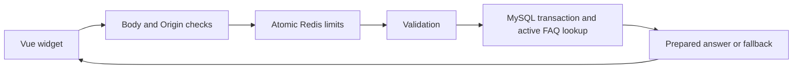

# Developer guide

This Laravel website includes a Vue 3/TypeScript public chatbot and an authenticated admin dashboard. Answers come from prepared MySQL FAQs or a fallback; there is no AI-provider integration. This guide reflects repository inspection on 2026-10-12. Examples are for local development and do not authorize production operations.

## Contents

- [Local setup](#local-setup)
- [Architecture and contracts](#architecture-and-contracts)
- [Admin and FAQ workflows](#admin-and-faq-workflows)
- [Development and testing](#development-and-testing)
- [Troubleshooting](#troubleshooting)
- [Privacy and release gates](#privacy-and-release-gates)

## Local setup

### Prerequisites and bootstrap

Use Docker with Compose, Git and a Sail-compatible shell: macOS/Linux or Windows through WSL2. The project declares Laravel `^13.17` and PHP `^8.3`; its Sail runtime targets PHP 8.5, with MySQL 8.4 and Redis. Frontend tooling includes Vue 3, TypeScript, Vite and Tailwind; tests use PHPUnit and Vitest/Vue Test Utils with jsdom.

Follow [AGENTS.md](../AGENTS.md). Check prerequisite availability with `php -v` and `composer -V`, but execute application PHP, Composer, Artisan and npm through Sail whenever available. Keep the existing Compose configuration; do not regenerate it with `sail:install`.

From the repository root, copy `.env.example` to `.env` only if `.env` is absent. Never overwrite configured secrets or commit `.env`.

If `vendor/bin/sail` is missing on a fresh clone, bootstrap the locked dependencies in Docker. This adapts the [official Sail Composer bootstrap pattern](https://laravel.com/framework/docs/11.x/sail#executing-composer-commands):

```sh
docker run --rm \
    -u "$(id -u):$(id -g)" \
    -v "$PWD:/var/www/html" \
    -w /var/www/html \
    laravelsail/php84-composer:latest \
    composer install --ignore-platform-reqs --no-scripts
```

The temporary image uses PHP 8.4; the actual application runs PHP 8.5. Platform ignoring is only for bootstrapping the missing Sail executable. Validate dependencies normally inside Sail below. Bootstrap skips application scripts. Do not use `composer update` for installation or the aggregate `composer setup` script as a shortcut: the latter includes migration with `--force`.

### Environment configuration

The example file defaults to SQLite and host-local Redis. Override them for this project's MySQL/Redis container services before migrating.

| Setting | Local value or purpose |
| --- | --- |
| `APP_ENV` | `local` |
| `APP_URL` | Actual browser URL for the configured published app port |
| `DB_CONNECTION`, `DB_HOST`, `DB_PORT` | `mysql`, `mysql`, `3306` |
| `DB_DATABASE`, `DB_USERNAME`, `DB_PASSWORD` | Local schema, non-root app user and secret consistent with Compose initialization |
| `REDIS_HOST`, `REDIS_PORT` | `redis`, `6379` |
| `REDIS_PASSWORD` | Match Redis authentication; checked-in development Redis has no password |
| `SESSION_DRIVER` | `database`, required for targeted admin session invalidation |
| `CHATBOT_ORIGIN` | Exact browser scheme/host/port, no trailing slash |
| `CHATBOT_HMAC_KEY` | Dedicated securely generated secret, at least 32 bytes; separate from `APP_KEY` |
| `CHATBOT_REDIS_HOST`, `CHATBOT_REDIS_PORT`, `CHATBOT_REDIS_DB` | `redis`, `6379`, `2`; username/password must match the service |
| `CHATBOT_OPERATOR_USERS` | Explicit local OS account allowlist, normally `sail` inside Sail |
| `CHATBOT_TRUSTED_PROXIES` | Empty for direct local access; only verified IPs/CIDRs for proxied access |
| `CHATBOT_ADMIN_RESTORATION_DIRECTORY` | Optional locally; when unset defaults to `storage/app/private/chatbot-deletions` |

An explicit empty `CHATBOT_OPERATOR_USERS=` copied from the example denies console management, overriding the local `sail` fallback. It is an OS identity allowlist, not an admin email or Laravel user ID. Production defaults to no access and requires individually authenticated operator identities.

Compose publishes the app on `APP_PORT` (default 80), Vite on `VITE_PORT` (default 5173), and database/Redis on configured forwarding ports. With default web port the browser origin is `http://localhost`; include an already configured non-default port in `APP_URL` and `CHATBOT_ORIGIN`. Do not change published ports silently. Container connection ports remain 3306/6379 independently of host forwarding ports.

Changing MySQL initialization credentials in `.env` does not recreate accounts in an existing volume. Resolve existing-volume credentials through an authorized database workflow; do not delete volumes to make setup pass.

### Start the local application

After configuring `.env`, run:

```sh
./vendor/bin/sail up -d
./vendor/bin/sail composer install
./vendor/bin/sail composer check-platform-reqs
./vendor/bin/sail npm ci
```

For a new local installation, generate `APP_KEY` only if it is missing. Never casually regenerate an existing key. Review migration status, verify the database is your intended local database, then apply incremental migrations:

```sh
# Only when APP_KEY is missing:
./vendor/bin/sail artisan key:generate
./vendor/bin/sail artisan migrate:status
./vendor/bin/sail artisan migrate
```

Migration changes the configured database. The schema includes users/sessions, FAQ/question tables and `users.is_chatbot_admin`; no admin is granted automatically. Do not reset the database or automatically seed real business claims.

Run Vite in another terminal, or build assets:

```sh
./vendor/bin/sail npm run dev
# Alternatively:
./vendor/bin/sail npm run build
```

Open the configured `APP_URL`. The public website is `/`, admin login `/admin/login`, and dashboard `/admin/chatbot`. Stop local services without deleting data using `./vendor/bin/sail stop`.

## Architecture and contracts

| Area | Location and responsibility |
| --- | --- |
| Routing/bootstrap | `routes/web.php`, `routes/api.php`, `routes/admin.php`, `bootstrap/app.php` |
| Public backend | `app/Chatbot/`, public controller/request and chatbot middleware in `app/Http/` |
| Persistence | `app/Models/{Faq,ChatbotQuestion,User}.php` and `database/migrations/` |
| Admin backend | `app/Chatbot/Admin/`, `app/Http/Controllers/Admin/`, policies and admin middleware |
| Admin presentation | `resources/views/admin/`, `resources/js/admin/` |
| Public widget | `resources/js/components/chatbot/`, `resources/js/chatbot/`, `resources/js/composables/useChatbot.ts` |
| Frontend integration | Existing `resources/js/app.js` and Vite configuration, with conditional public/admin mounting |
| Console/scheduler | `routes/console.php` |
| Test isolation | `compose.chatbot-tests.yaml`, `tests/bootstrap.php`, `tests/Support/` |

Blade hosts Vue components in one frontend build. There is no separate SPA or public management API. Mock responders remain injectable for tests but are not a production fallback after server errors.

### Public chatbot



`POST /api/chatbot/questions` accepts stateless JSON. The widget omits cookies and sends UUID-v4 session/request IDs. Session identity uses sessionStorage with page-memory fallback; the database stores its HMAC, not the raw session UUID. Retry preserves the original logical IDs.

Synthetic request fixture:

```json
{
  "question": "What is this chatbot?",
  "session_id": "11111111-1111-4111-8111-111111111111",
  "request_id": "22222222-2222-4222-8222-222222222222"
}
```

The response `data` contains `request_id`, `status`, `reply_source`, `answer` and `replayed`. First collection returns 201; replay returns 200. Same session/request with different question text returns 409. Generate real IDs cryptographically rather than reusing fixtures.

Question bounds are 1–1,000 trimmed Unicode code points; prepared answers allow 1–4,000. Shared normalization applies NFC, Unicode whitespace trimming/collapse and Unicode lowercase before exact matching. Punctuation and accents matter; fuzzy/substring chatbot matching is absent. A unique digest includes inactive FAQs, and lookup also verifies normalized equality.

Stored `status` represents original classification. `reply_source` describes the current FAQ/fallback response. An original miss can receive a newly activated answer while remaining unanswered; an original answer falls back if its recorded FAQ is unavailable/inactive. Replay never reclassifies the row or extends retention age.

The endpoint has a 16 KiB body cap, exact configured Origin, atomic 10/session and 30/IP attempts per 60-second window, strict validation, no-store responses and plain-text rendering. Frontend requests time out after 15 seconds without silently using mocks.

### Authenticated administration

Private web/JSON routes reuse the Laravel web session guard, CSRF middleware, dashboard gate and resource policies. `is_chatbot_admin` defaults false and is excluded from ordinary mass assignment. Guests cannot read management data; authenticated non-admins get 403. Private responses are no-store and admin bodies are capped at 32 KiB.

Admin sessions expire after 30 minutes idle or 8 hours absolute, with no remember-me. Login/password confirmation allows 5/account and 20/IP attempts per 60 seconds; protected requests allow 120/admin. The explicit Redis connection is independent of the default cache store and fails closed on outage.

Question DTOs omit session hashes/request identifiers. Searches use CSRF-protected POST bodies, default 25/max 50 rows and cursor pagination. Admin substring search is distinct from chatbot exact matching.

FAQ mutations reuse `FaqService` and compare expected revisions under row locks. A 409 requires deliberate reload; there is no automatic overwrite. Content edits deactivate, while no-op edits preserve state. Collected questions remain immutable except authorized hard deletion.

## Admin and FAQ workflows

### Accounts and password resets

After local migrations and operator allowlist configuration:

```sh
./vendor/bin/sail artisan chatbot:admin:create
```

Enter name, unique email and password in protected prompts, then confirm. Passwords must match, contain 12–128 Unicode characters, contain no NUL and satisfy the configured hashing algorithm. With bcrypt the maximum is 72 bytes; multibyte text can reach it before 72 characters. Never put credentials in arguments, logs or Git.

Replace `USER_ID` with the verified target's internal ID before running these commands:

```sh
./vendor/bin/sail artisan chatbot:admin:grant USER_ID
./vendor/bin/sail artisan chatbot:admin:revoke USER_ID
./vendor/bin/sail artisan chatbot:admin:password-reset USER_ID
```

Grant does not create a missing user. Reset prompts for the new password and confirmation. Revoke/reset delete that user's database sessions. Determine the ID through an authorized account lookup without dumping hashes or unnecessary personal data; do not assume account 1. Browser signup/account management/email recovery are outside this feature.

### Prepare and activate an answer

In the dashboard, review visitor questions and select **Create FAQ draft**. It prefills an editable question with a blank answer. Remove personal details, supply a verified plain-text answer and save. Review and explicitly activate the inactive FAQ on its detail page. Preparation never edits or marks the collected question resolved.

Console alternatives (replace `FAQ_ID` with the actual ID):

```sh
./vendor/bin/sail artisan chatbot:faq:create
./vendor/bin/sail artisan chatbot:faq:list
./vendor/bin/sail artisan chatbot:faq:show FAQ_ID
./vendor/bin/sail artisan chatbot:faq:update FAQ_ID
./vendor/bin/sail artisan chatbot:faq:activate FAQ_ID
./vendor/bin/sail artisan chatbot:faq:deactivate FAQ_ID
./vendor/bin/sail artisan chatbot:questions:review --limit=50
```

Create/update prompt for content and confirmation. Console list is limited to the first 50 FAQs; browser tables support searching/pagination. Protected multiline stdin and review-cursor procedures are in the [005 runbook](../specs/005-chatbot-question-collection-faq/operations.md#faq-preparation-and-review).

Web deletion requires explicit confirmation and recent password verification (15 minutes). FAQ deletion clears references without changing original classification. Question hard deletion requires protected restoration metadata first; sink failure prevents deletion. No bulk export, mutable review status or public deletion endpoint exists. See the [006 runbook](../specs/006-chatbot-admin-dashboard/operations.md).

## Development and testing

### SDD/TDD workflow

Read feature requirements/design/tasks/acceptance before application changes. Obtain specification approval, work in task order, write meaningful failing acceptance-linked tests, implement the minimum fix and record green results before refactoring. Preserve IDs and historical evidence. Never invent missing red chronology, silently change approved requirements or commit automatically.

Use current source documents rather than the old baseline summary in `specs/README.md`:

- [001 widget](../specs/001-chatbot-widget/requirements.md)
- [004 Minimal SaaS UI](../specs/004-chatbot-minimal-ui/requirements.md)
- [005 question collection and FAQs](../specs/005-chatbot-question-collection-faq/requirements.md)
- [006 admin dashboard](../specs/006-chatbot-admin-dashboard/requirements.md)

### Isolated verification

Use dedicated test-only MySQL/Redis services, not development services. They have an internal network, tmpfs storage, no published ports or shared development data volumes. The runner uses the `sail-8.5/app` image built by local Sail; build/start local Sail first if the image is absent.

```sh
SAIL_FILES=compose.chatbot-tests.yaml APP_SERVICE=chatbot-test-runner ./vendor/bin/sail up -d
SAIL_FILES=compose.chatbot-tests.yaml APP_SERVICE=chatbot-test-runner ./vendor/bin/sail artisan test --filter='IsolationGuardTest|AdminIsolationGuardTest'
SAIL_FILES=compose.chatbot-tests.yaml APP_SERVICE=chatbot-test-runner ./vendor/bin/sail artisan test
./vendor/bin/sail npm run test:frontend
./vendor/bin/sail npm run typecheck
./vendor/bin/sail npm run build
./vendor/bin/sail php vendor/bin/pint --test
```

Stop if the guard suite fails. Bootstrap/guards verify testing environment, hosts, credentials, URL/connection overrides, cached config, session/Redis routing and owned schema/key namespaces before integration connections or writes. Race tests use verified isolated connections. A database named `testing` alone is insufficient. The full suite includes a real roughly 60-second Redis reset observation and concurrency tests.

Plain Sail `artisan test` outside this runner skips real-service chatbot tests; it is not equivalent acceptance evidence. The aggregate Composer test script also clears configuration and is not the isolated workflow. Never use migration resets, Redis flushes, broad cache clearing, `--remove-orphans` or Docker volume deletion as cleanup. Correct unsafe configuration rather than bypassing guards.

Backend tests live in `tests/Unit/` and `tests/Feature/`; frontend tests in `tests/frontend/`. Use synthetic records and preserve public widget avatars, speaker labels, keyboard/IME, focus, retry, pending-close and unmount behavior.

### Evidence and browser checks

[006 evidence](../specs/006-chatbot-admin-dashboard/evidence/application.md) records historical 2026-10-10 results: 70 PHPUnit tests/864 assertions, 63 Vitest tests, typecheck/build/Pint passing. These are dated results, not reruns for this documentation change. The recorded build warning concerns optional font optimization; no dependency was added. Existing historical TDD limitations remain explicit in [005 evidence](../specs/005-chatbot-question-collection-faq/evidence/application.md) and 006 evidence.

Browser verification remains separate: 320×568/1440×900 viewports, 200% zoom, wrapping/reduced motion, keyboard/sidebar/dialog focus, actual screen-reader speech, login/CSRF/session networking and public widget appearance/lifecycle. DOM tests do not establish visual or spoken acceptance. Record actual observations and leave unrun checks pending.

## Troubleshooting

| Symptom | Checks and next step |
| --- | --- |
| Sail cannot start | Check Docker engine access and service health; explain/resolve port conflicts without deleting volumes. |
| Admin operation fails before prompts | Verify the actual container OS identity and nonempty operator allowlist. |
| Admin create/grant fails | Check migration status/admin column, unique email, valid name/password/confirmation or existing target ID, DB connectivity and writable restricted audit storage. |
| Password reset fails | Verify operator access, user ID, hidden input confirmation, character/bcrypt byte limits and sessions table. Never share the password. |
| FAQ operation fails | Check operator access, Unicode bounds, normalized duplicates including inactive rows and stale revisions. Do not expose raw exceptions/payloads. |
| Chatbot cannot send | Inspect Network response status without copying private payloads; verify exact Origin, schema, dedicated Redis/HMAC configuration, body/field validation and service health. |
| FAQ exists but fallback appears | Activate it; new/edited content is inactive. Compare normalized text including punctuation/accents. An originally answered replay uses only its recorded FAQ reference. |
| Admin 403 / 401 / 419 | Verify admin capability or sign in again for session/CSRF expiry; preserve the draft and reload deliberately rather than retrying writes automatically. |
| FAQ 409 | Duplicate normalized key or stale revision. Search existing FAQs or explicitly reload current data without overwriting the winning change. |
| 429 / 503 | Respect the quota wait; check Redis/key/database/restoration service configuration for 503 without weakening authorization or limits. |
| Question deletion blocked | Confirm password/confirmation and private durable restoration storage; sink failure must keep the row. |
| Isolated tests abort/skip | Use the dedicated runner and inspect guard errors; development credentials, URL overrides or cached configuration are not safe substitutes. |

Read-only local diagnostics include `./vendor/bin/sail ps` and `./vendor/bin/sail artisan migrate:status`. On a verified local database, install the missing admin column with the targeted incremental migration:

```sh
./vendor/bin/sail artisan migrate --path=database/migrations/2026_10_09_000006_add_chatbot_admin_to_users.php
```

That command changes the configured database; review the environment first. The 006 evidence records the earlier local repair on 2026-10-11, not proof that every checkout is migrated. Configuration caches can hide `.env` edits; resolve them through the intended environment's configuration workflow rather than broad cache clearing as a default.

## Privacy and release gates

Treat questions as potentially sensitive. Persistence includes original text/classification, optional FAQ reference, timestamps, session HMAC and deduplication request UUID as defined in 005. It does not add raw session UUIDs, visitor IP/profile fields or answer snapshots. Existing website/admin session metadata has a separate policy purpose. Never put real content, credentials or identifiers in ordinary logs, URLs, telemetry or documentation. Render text literally, without executable HTML/Markdown.

Questions have a 90-day UTC cutoff and daily bounded purge, normally within 91 days under healthy scheduling. Backups expire within 30 days and must reapply age purge/early deletions before restored service is exposed. Viewing/replaying/preparing an FAQ does not reset age. FAQs have a separate lifecycle.

Production selected-row deletion requires an explicit private writable `CHATBOT_ADMIN_RESTORATION_DIRECTORY` outside public serving, durable independently of DB restores. Records contain only internal row ID and creation/deletion times. Expiry handles at most 500 eligible metadata files per call; monitor backlog. Database sessions are required for implemented targeted reset/revocation.

Application approval does not establish production/privacy acceptance. Verify actual TLS/cookies, proxy/direct-access controls, ingress/PHP limits, private DB/Redis, individual console IAM/audit, log/APM redaction, scheduler/alerts, backup expiry/restore drills and privacy/security-owner approvals. Do not rotate APP_KEY/HMAC secrets or apply production migrations as local setup.

Detailed procedures and acceptance gates remain authoritative:

- [005 operator, retention and release runbook](../specs/005-chatbot-question-collection-faq/operations.md)
- [006 admin, restoration and release runbook](../specs/006-chatbot-admin-dashboard/operations.md)
- [005 acceptance](../specs/005-chatbot-question-collection-faq/acceptance.md) and [006 acceptance](../specs/006-chatbot-admin-dashboard/acceptance.md)

These workflows do not add AI integration, public management endpoints, separate frontend applications or automatic commits.
