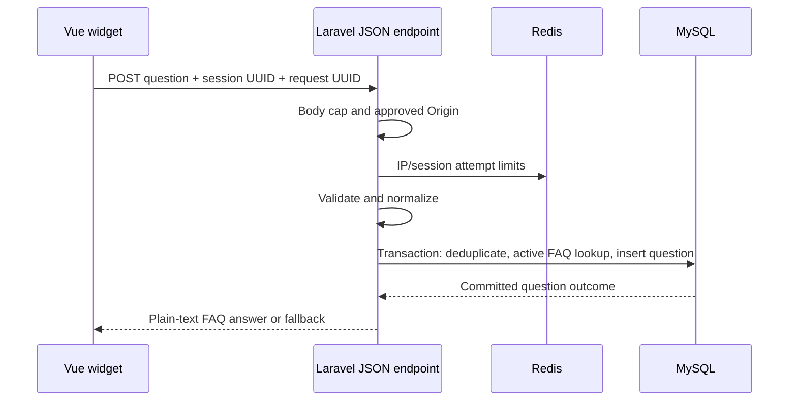

# 005 — Architecture and design

Status: Application implementation approved explicitly by the user in this session. Application implementation and automated verification recorded in [evidence](evidence/application.md); manual, production infrastructure and privacy-policy release gates remain pending.

## Observed baseline at initial specification drafting (historical)

Laravel `^13.17` currently registers web/console routes, with no routes/api.php. `bootstrap/app.php` already requests JSON exceptions for api/* paths. `useChatbot.ts` defaults to the cancellable local mock through `ChatResponder(message, signal): Promise<string>`. Vue components render interpolated text; validation counts code points after JS trim. Existing PHPUnit and Vitest infrastructure and frontend scripts are present. MySQL and Redis are project dependencies; this documentation does not establish running-service readiness. The requested `005-chatbot-question-collection` path does not exist; this existing `005-chatbot-question-collection-faq` directory remains canonical, without duplicating or renumbering specs.

## Request flow

Register a stateless API route group through existing bootstrap routing, without installing authentication tooling. Do not attach web session middleware or create a Laravel session to group questions. The widget uses fetch with `credentials: 'omit'`, JSON content type, Accept JSON and an AbortSignal. Origin is supplied by the browser and compared exactly against configured scheme/host/port, with no suffix/wildcard matching. No cross-origin allowance. Origin checking reduces browser cross-site abuse, not scripted abuse; Redis limits remain necessary. Because the endpoint uses no ambient credentials or cookies, it does not require a web-session CSRF bootstrap. Reassess this architecture if authenticated/cookie-based behavior is later introduced.

Suggested modules: `StoreChatbotQuestionRequest`, `ChatbotQuestionController`, `QuestionAnswerService`, `FaqNormalizer`, `ChatbotQuestion` and `Faq` models; dedicated chatbot atomic Redis limiter plus Origin/body-size middleware; `config/chatbot.php`; FAQ operator, unanswered-review, purge and operator-deletion commands. Keep controllers thin. No queue or external provider is needed for synchronous FAQ answers. Configuration includes trusted site Origin, dedicated secret HMAC key, request/answer limits, fallback text and retention days. Never log secrets. Key rotation requires a documented maintenance plan: stop submissions, expire tab IDs, and handle retained old hashes; do not silently break operator deletion/deduplication.

## Persistence

| Table / field | Definition and purpose |
| --- | --- |
| `faqs.id` | Internal primary key |
| `question`, `answer` | Plain-text TEXT values; validated code-point bounds |
| `normalized_question` | TEXT, binary comparison; computed by shared normalizer |
| `match_key` | Unique fixed-length SHA-256 of normalized UTF-8 text; recheck normalized text equality on lookup, never trust hash equality alone |
| `is_active` | Boolean, default false |
| `created_at`, `updated_at` | UTC timestamps |
| `chatbot_questions.id` | Internal primary key; not exposed publicly |
| `session_hash` | 64-character HMAC-SHA-256 over canonical session UUID using dedicated secret |
| `request_id` | Canonical UUID v4, unique together with session_hash |
| `question` | Trimmed original TEXT; not normalized for display/review |
| `status` | String constrained by application to answered/unanswered |
| `faq_id` | Nullable FK; ON DELETE SET NULL |
| `created_at`, `updated_at` | UTC timestamps; replay never touches creation/retention age |

Indexes: unique `(session_hash, request_id)`; `(status, created_at, id)` for review; `(created_at, id)` for purging; unique FAQ match_key. No raw session UUID, IP, answer snapshot or soft-delete column. Use bound parameters; match keys avoid oversized MySQL Unicode indexes and collation-dependent matching. Normalization is a versioned application contract shared across FAQ writes and lookup, using PHP Unicode normalization/lowercase support. Verify required intl/mbstring support in Sail before implementation. Define trimming/whitespace explicitly as ECMAScript trim whitespace plus Unicode White_Space (including FEFF at edges); implement the same rule client/server and use shared fixture vectors. Count code points, not bytes or grapheme clusters. Lowercase is not accent stripping or Unicode case folding (e.g. “straße” does not match “STRASSE”).

FAQ model/service writes always derive normalized_question/match_key and validate question/answer. Concurrent same-key FAQ creation fails clearly, not arbitrary priority selection. A hash collision with unequal normalized strings is rejected for authoring and treated as no match for lookup. Do not automatically seed production. Example opt-in data: “What is this chatbot?” → “This demo answers prepared FAQs. It does not use AI.” and “Can I include personal information?” → “Please do not include personal or sensitive information.” No invented business pricing/support promises.

## Atomic submission and replay

In one transaction, find existing session/request tuple first. Compare exact trimmed question; mismatch yields 409. Otherwise replay as R-07 specifies. For new input, normalize, lookup one active FAQ, and insert answered with FAQ reference or unanswered with null. Capture answer for the response within the operation; commit before responding. Database error yields generic 503 without a partial accepted row. Concurrent unique-key insertion conflicts are recovered after rollback by reading the winning row and applying replay/conflict rules; never swallow unrelated SQL failures. Tests use separate MySQL connections for actual races. For a replay whose original status is answered, use only its stored FAQ reference: return the current answer if that FAQ remains active, otherwise fallback (do not substitute another FAQ). For a replay whose original status is unanswered, perform current active exact-match lookup using the original question: a newly prepared/activated FAQ may supply a current answer, but do not assign faq_id or change status/timestamps. Replay metadata describes original classification; returned text can change with current FAQ content. This tradeoff avoids retaining answer snapshots and guarantees row deduplication, not immutable responses.

## API contract

Request: `{"question":"What is this chatbot?","session_id":"<UUID v4>","request_id":"<UUID v4>"}`. No history or role field.

First acceptance: HTTP 201. Replay: HTTP 200. Both: `{"data":{"request_id":"<UUID>","status":"answered","reply_source":"faq","answer":"This demo answers prepared FAQs. It does not use AI.","replayed":false}}`. Status is original stored classification; reply_source is `faq` or `fallback` for the text returned now. No database/FAQ IDs or session hash. New misses use unanswered/fallback. Examples: an original answered row after FAQ deactivation returns `status=answered, reply_source=fallback`; an original unanswered row after a matching FAQ is prepared/activated returns `status=unanswered, reply_source=faq`. Both preserve collection history; the frontend must not derive reply success or text from status. Client consumes answer only after validating the full expected response shape, matching request_id and bounded nonblank answer.

| Failure | HTTP / body behavior |
| --- | --- |
| Unapproved/missing Origin | 403, generic message |
| Oversized body | 413, generic message; infrastructure and app caps aligned |
| Non-JSON content type | 415, generic message |
| Invalid schema/question/UUID | 422, field error codes/messages without input values |
| Same key, different question | 409, generic conflict |
| Limit exceeded | 429 with positive Retry-After seconds |
| Redis/database unavailable | 503, generic retryable message |
| Unexpected failure | 500, generic message; sanitized operational report |

All responses include `Cache-Control: no-store`; no raw input in errors. Size/Origin rejection precedes limiter; admissible POST attempts consume limiter budgets before schema validation. Rate limits use atomic acquisition on a dedicated configured Redis connection, with a 60-second window starting at the first acquired attempt for each key and non-sliding expiry of at most 120 seconds. Increment/check in one operation; never use separate check-then-hit operations as a concurrency guarantee. Consume IP first, then valid session UUID quota, before schema validation; a session rejection still consumes IP budget. Test parallel threshold acquisition, exact reset and TTL on real Redis. Generic 503 handling wraps connection/script errors before persistence. Do not globally remap unrelated website throttles. Use separate HMAC domains for IP and session keys. No limiter key payloads in logs. Do not introduce durable IP bans.

## Repository compatibility review and required verification

This is static verification against checked-in configuration and installed framework source, not a live deployment test. No production manifests, reverse-proxy configuration, runtime PHP configuration or ingress/privacy policy are present in the inspected repository; production compatibility is pending evidence.

| Concern | Observed configuration/source | Required application action and release evidence |
| --- | --- | --- |
| Routing / Origin / sessions | bootstrap/app.php has web/console routing only and api/* JSON exception rendering. Installed ApplicationBuilder supports api routing with default api prefix; Middleware has stateless api group by default. Web group starts sessions and request-forgery protection. .env.example APP_URL is http://localhost:8000; Compose publishes APP_PORT default 80. | Register routes/api.php once without duplicating /api; attach endpoint-specific controls without web/stateful middleware. Configure exact external Origin including actual local port, independently of APP_URL/Host. Browser POST with credentials omitted must succeed from actual local and deployed URLs; missing/null/foreign Origins fail. Preserve host-page web behavior; existing web-session IP/user-agent collection is a separate baseline policy concern, not new chatbot storage. |
| Body parsing/limits | Default global middleware includes ValidatePostSize, TrimStrings and ConvertEmptyStringsToNull. ValidatePostSize compares CONTENT_LENGTH to PHP post_max_size; Sail php.ini sets 100M. | A route middleware after global trimming is too late to enforce a pre-parse cap. Add endpoint-specific early global middleware before transformations/body parsing to read at most 16,385 bytes and enforce <=16,384 bytes; reject larger claimed or actual bodies (including absent/incorrect Content-Length). Keep unrelated routes unchanged. Skip default trim/null conversion on this endpoint and run shared Unicode trimming after strict type validation. Prove ordering, chunked/missing-length behavior, exact cap boundary and JSON 413/no-store within application. Production ingress must enforce its own bounded reads and document any pre-Laravel 413 format; the adapter must safely handle non-JSON edge errors. |
| Redis quotas | config/cache.php defaults database; .env.example CACHE_STORE=database; phpunit.xml CACHE_STORE=array. A Redis cache store exists, but no chatbot limiter is wired. Installed ThrottleRequestsWithRedis uses default Redis connection and separate tooManyAttempts/hit calls. | Choose endpoint-specific atomic acquisition on an explicit chatbot Redis connection rather than assuming named/default throttling is Redis-backed or sufficient for strict parallel thresholds. Verify dedicated connection, key domains, TTL, unavailable-Redis failure and retry headers. Do not change site-wide cache behavior. |
| Proxies / client IP | bootstrap has no explicit trustProxies configuration. Global TrustProxies is present; installed source contains provider-specific implicit trust branches, so absence of configuration is not proof of safe deployment defaults. | Explicitly configure trusted proxy addresses/CIDRs and header mask (or explicit no-proxy trust locally), with no wildcard. Test direct spoofed forwarded headers and trusted proxy chains. Production owner must verify ingress strips/overwrites attacker-supplied headers, scheme/port/client-IP preservation and blocked direct backend access; verify provider-specific behavior rather than guessing topology. |
| Runtime/deployment | Compose runs Sail PHP 8.5, MySQL 8.4 and Redis with persistent development volumes and host ports; no production ingress is described. phpunit.xml selects testing DB but not explicit DB_CONNECTION/host/credentials or Redis isolation. | Do not change existing published ports/volumes. Verify actual Sail Unicode extensions and isolated service health during approved work. Production TLS, body limits, IAM, logging, backups and topology require separate owner-supplied evidence. |

Middleware order for this endpoint: early bounded-body check; global proxy resolution (before IP-derived quotas); configured Origin/content-type guards; dedicated Redis quotas; strict JSON schema and shared trim; transaction. Wrap application errors with generic JSON and no-store without exposing payloads. Size rejection may occur before Origin checking; neither consumes application quota. Infrastructure rejection may occur before Laravel and cannot be asserted by Laravel tests.

## Restricted operator workflow (included in Feature 005)

Authentication is the existing server/deployment boundary: individually authenticated OS/SSH or IAM identities granted console execution, with restricted application/database permissions. Laravel Artisan does not authenticate web users and APP_ENV/CLI execution/an `--operator` string are not authorization. Production must restrict shell, container-exec and deployment runner permissions so only authorized operators can invoke these commands; do not store operator passwords or accept visitor credentials. Local Sail invocation is for authorized developers. Verify the infrastructure boundary separately; if it cannot enforce authenticated operator access, do not release management/review commands for production use. No public route invokes Artisan.

Proposed commands (approved application names/contracts): `chatbot:faq:create`, `chatbot:faq:update <faq-id>`, `chatbot:faq:activate <faq-id>`, `chatbot:faq:deactivate <faq-id>`, `chatbot:faq:list`, `chatbot:faq:show <faq-id>`, and `chatbot:questions:review`. Use Sail Artisan locally, the authorized deployment console in production. No FAQ content or visitor question/identifier in command arguments, shell history or audit logs. Read content through protected multiline prompt/stdin, not interpolation into a shell. Escape displayed control characters and markup-like text as literal text; previews never execute terminal escapes.

1. Create: collect question/answer, validate shared limits/normalization, preview escaped content and canonical key, confirm, atomically create inactive. Cancellation/invalid/duplicate input changes nothing; return nonzero on invalid/conflict, not a successful message.
2. Update: load/show current version, capture revision token derived from canonical row values, accept/validate proposed fields, preview changed fields, confirm and compare under row lock. If the revision changed, reject and ask to reload rather than overwrite. Any question/answer edit sets inactive atomically, even when previously active; a no-op does not silently deactivate.
3. Activate: preview current validated question/answer/version, confirm publication, verify unchanged revision under row lock, activate. Deactivate: identify record, confirm, concurrency-check and set inactive. Repeated activate/deactivate of already requested state is a harmless no-op. Commands never reclassify collected rows. No FAQ delete command in this feature; FK deletion behavior remains tested for future management.
4. Audit: record verified operator identity from the trusted access boundary, action, FAQ ID, UTC time and outcome in restricted audit storage, without question/answer/visitor payloads. Identity comes from authenticated platform/OS execution records, never caller-supplied identity options. No new visitor/FAQ audit DB schema is needed. Missing attributable access/audit controls blocks production operation.
5. Review: read-only oldest-first originally unanswered rows, keyset cursor `(created_at,id)`, default/max page size 50, escaped question text, row ID and UTC time only. Display no session hash/request UUID; no export or broad query options. A follow-on page is explicit, not automatic dumping. Empty results are a successful empty page; concurrent purge is safe and skipped rows do not cause cursor loops. Review does not mark rows answered/reviewed, extend retention or save notes.
6. Preparation loop: operator uses reviewed text to author an independent inactive FAQ, verifies accuracy/privacy, then activates it. Do not copy unnecessary personal data into FAQ content. New submissions can now match it; replay of an original miss can return it while retaining unanswered history. Browser admin review, review-state tracking and export are explicitly deferred to a separately approved follow-up, with no feature number reserved.

## Isolated integration-test contract

Use dedicated test-only MySQL and Redis services with no shared development/production data volumes, no published host ports and separate test credentials/network access. Preserve current development Compose ports and volumes. A Redis database number or prefix alone on the development server is not sufficient isolation. Use a run-specific MySQL schema and Redis namespace on the dedicated test services for concurrent workers; test credentials cannot access development schemas/resources.

Before opening connections, applying test schema, deleting test rows or setting keys, bootstrap must verify APP_ENV=testing, exact allowlisted test hosts/service identities, test credentials, run-specific schema/prefix, absence of inherited DB_URL/REDIS_URL overrides and no cached development/production configuration. Abort when guards fail or config cannot be verified. All separate MySQL race-test connections use the same verified test schema. No FLUSHALL/FLUSHDB, shared cache clear, volume deletion, production/dev migration reset or unbounded wildcard cleanup. Clean up only owned test rows/keys; leave shared resources untouched. Test creation/teardown uses narrowly scoped test resources and AGENTS.md restrictions; database readiness must be provisioned without destructive database commands.

Real Redis script timing uses its actual window clock; injected/frozen application clocks alone do not prove Redis reset. Record parallel-acquisition outcomes and bounded real-clock TTL/reset evidence separately from fake-clock unit tests. Namespaces plus barriers isolate repeated runs; never use production payloads as fixtures.

## Frontend boundary

Add `apiResponder.ts` and a tab identity/exchange helper while retaining the string-returning injected ChatResponder. Extend the responder call with an optional typed exchange context containing requestId/sessionId; existing two-argument mock responders remain compatible. The composable owns one immutable context per logical submission and retains it with failed input through retries. Generate UUIDs using browser cryptographic randomness; fail clearly if secure randomness is unavailable, never use Math.random. Access sessionStorage lazily and handle denied access. Identity carries an issuance time for 24-hour rotation; closing does not rotate it. Browser duplication may copy initial sessionStorage: identity is a convenience grouping, not guaranteed unique people/tabs.

API adapter uses 15-second timeout and abort cleanup, verifies response contract and throws typed transport/protocol errors. Do not silently fall back to local mocks on server failure. A 429 disables Retry until Retry-After elapses and communicates wait time through existing feedback area; no automatic resubmission. Other failures enable Retry immediately. Backend 422 messages map to existing associated validation presentation where practical, retaining the already-added user entry; corrected text is a new logical submission. Close does not abort; unmount aborts/ignores late completion. A timeout/unmount can occur after commit, hence the durable request UUID. New sends dismiss old retry state as before. Notice and error copy are the only planned product-copy changes; an extra rate-limit wait message is permitted for actionable errors.

Preserve mount, CSS, avatars, dialog/log/status/alert, keyboard/IME, focus and responsive behavior. No transcript restoration, history requests or browser storage of messages. No visual redesign or new dependency is proposed beyond verifying existing runtime Unicode support.

## Privacy operations and verification

Treat question text as potentially sensitive. Limit application/database access to operators; infrastructure access logs must omit client IP and request bodies for this endpoint, and APM/request inspectors must redact payloads. Sanitized logs may include event class, HTTP status and duration only. Verify this deployment configuration rather than assuming application tests prove it. sessionStorage UUIDs and HMACs are pseudonymous, not irreversible anonymization.

Daily purge uses an injected/testable UTC clock, indexed age selection, bounded batches (500 rows), no overlap and retry on later schedules. An operator command accepts the UUID through a protected interactive prompt/stdin, not shell arguments/history; deletes exact hash matches in batches and does not log token/text. It cannot authenticate a visitor and must not become a public tool. Monitor last successful purge/count without question/session content; failed daily schedule raises an operational alert. Backups expire after 30 days; retain access-controlled deletion instructions for the backup lifetime and reapply before opening restored service. Backup erasure/restore evidence is a deployment acceptance gate, not a claim of immediate physical erasure.

Backend PHPUnit covers schema, normalization, API errors, transactions, idempotency and lifecycle. Dedicated isolated MySQL/Redis test services cover actual collation/unique races and atomic quotas (never production databases, destructive reset commands or volume deletion). Vitest covers adapter contracts, UUID/storage lifecycle, retries/timeouts and preserved widget behavior. Browser checks prove unchanged geometry/accessibility, actual network behavior, notice readability, safe rendering and request privacy. See [acceptance](acceptance.md) for traceability.

## Acceptance boundaries

Application verification: unit/feature/integration tests, command validation/concurrency/output, API middleware order/body cap/Origin/no-store/atomic quotas, Vue regression and browser accessibility evidence. Passing these supports application readiness only.

Production infrastructure acceptance: verified operator authentication/authorization/audit, deployment Origin and proxy/IP topology, ingress/body cap/TLS, restricted MySQL/Redis access, payload-safe logs/APM, scheduler/alerts and backup restore/deletion evidence. Configuration inspection identifies pending work; it cannot establish these gates are passed.

Privacy/product acceptance: the owner approves public wording, lawful/appropriate collection purpose, scope/access, retention (90-day threshold plus up to one daily interval), backup expiry and deletion request limitations. Proposed notice says “Questions are normally deleted within 91 days” to match daily purge behavior; failed jobs and backup lifetimes belong in the full policy. No collection release until all three records are approved, while engineering checks may complete with external gates explicitly pending.
